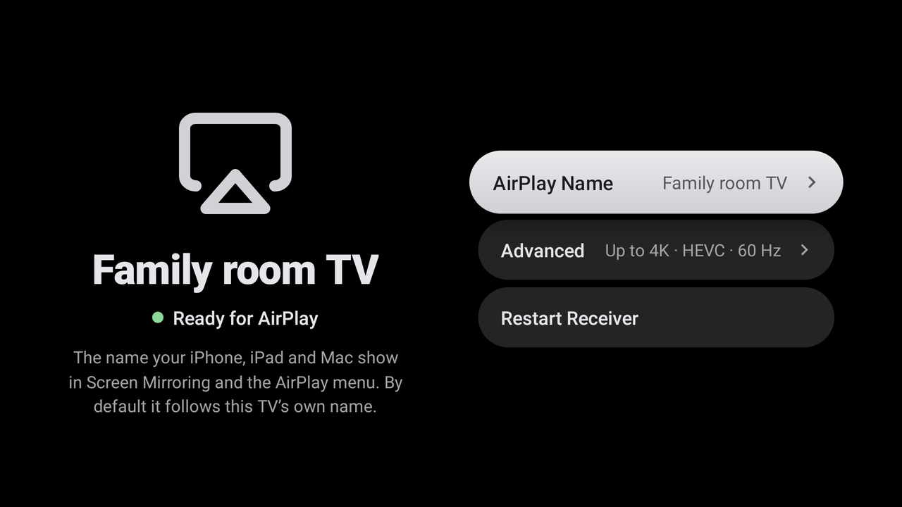
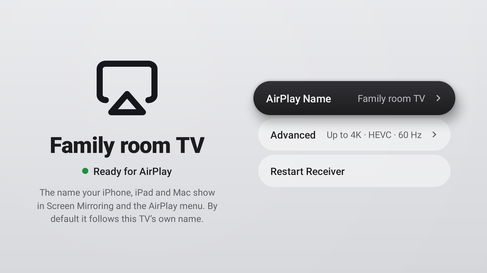
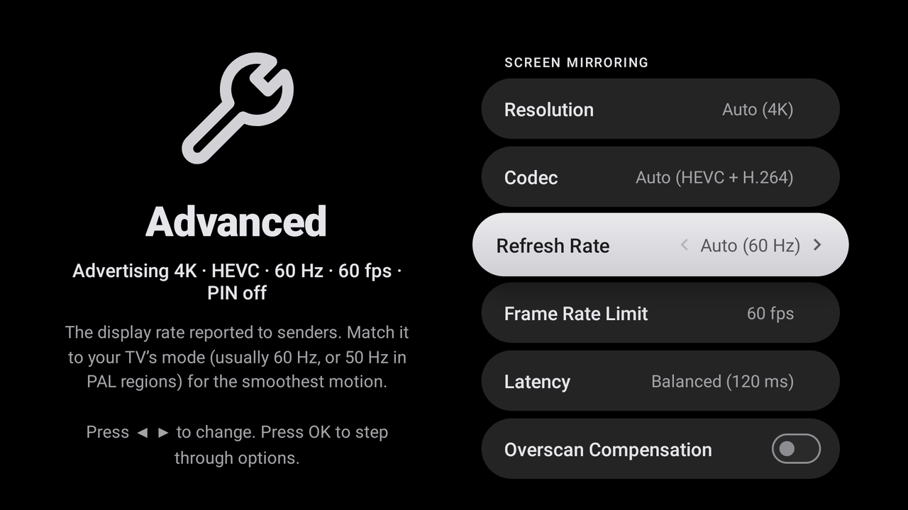
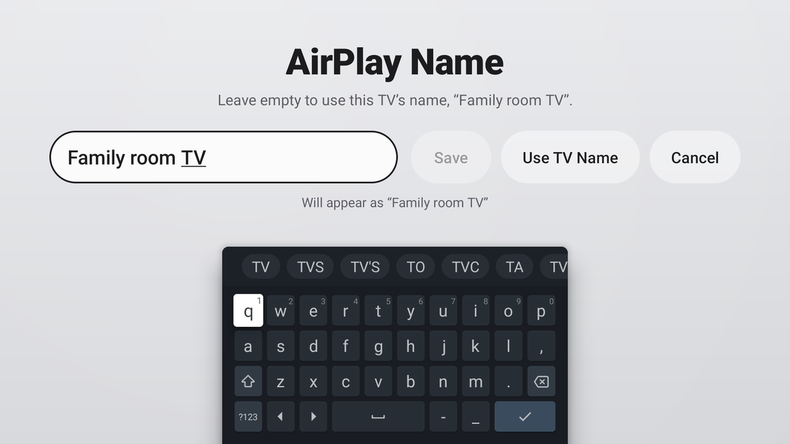

# better_airplay

An always-on AirPlay receiver for Android TV and Google TV. Pick the TV in Control Center on your
iPhone, iPad or Mac and it wakes up, takes over the screen, and plays. There's nothing to open on the TV.

<p align="center">
  
  
</p>

## What it does

- **Screen mirroring** up to 4K in HEVC (H.265) on TVs that can decode it, or 1080p H.264. Hardware
  decoding with a low-latency path, and the TV's "game" picture mode while mirroring.
- **Music and podcasts** with a Now Playing screen: artwork, title, artist and album, a live progress
  bar, and a background tinted from the album art. The TV remote's play/pause and next/previous
  buttons control the phone.
- **Video handover**: in YouTube, tap AirPlay and the video itself plays on the TV, so your phone stays
  free. Scrubbing, pause and stop on the phone control the TV, and the phone's scrubber follows it.
  Direct video URLs (such as Safari's AirPlay button) go the same way.
- **Always on**: starts at boot, stays advertised, wakes the screen when a device connects, and goes
  back to what you were watching when it disconnects.
- **Optional on-screen PIN** the first time a new device connects.
- **A tvOS-style interface** that follows the TV's light/dark setting.

<p align="center">
  
  
</p>

## What it can't do

These are limits of AirPlay outside Apple's licensed implementations, not bugs:

- **DRM-protected video** (Netflix, the Apple TV app, Disney+, Prime Video). It needs Apple-licensed
  FairPlay, which only TV makers like Sony, LG and Samsung have. Open the service's own TV app instead.
- **AirPlay 2 multi-room audio.** Its timing protocol needs network ports an ordinary Android app
  can't open without root.
- **Miracast.** Android reserves the Wi-Fi Display permissions for system apps.

Video handover plays H.264 up to 1080p. Android's built-in player can't read YouTube's VP9
variants, so they're filtered out. For 4K/HDR YouTube, use the YouTube app's own
"Watch on TV" instead: that plays in the YouTube TV app.

## Requirements

- An Android TV or Google TV device running Android 8.0 (API 26) or later, ARM (32- or 64-bit).
- An iPhone, iPad or Mac on the same network.

## Build and install

There are no prebuilt releases yet; build it from source.

1. Install [Android Studio](https://developer.android.com/studio). From its SDK Manager, add
   **NDK 29.0.14206865** and **CMake 3.31.6**.
2. Clone with submodules (UxPlay, BoringSSL, libplist and ALAC are built from source):
   ```sh
   git clone --recursive https://github.com/raazifaisal/better-airplay.git
   cd better-airplay
   ```
3. Turn on ADB debugging on the TV (Settings → Device Preferences → About → tap Build seven times,
   then Developer options → USB/Network debugging) and connect: `adb connect <tv-ip>:5555`.
4. Build, install, provision and start, all in one step (it then follows the logs; Ctrl+C to stop):
   ```sh
   tools/deploy.sh <tv-ip>:5555
   ```
   Or by hand: `./gradlew assembleDebug`, then `adb install -r app/build/outputs/apk/debug/app-debug.apk`
   and `tools/provision.sh <tv-ip>:5555`.

`tools/provision.sh` runs once over ADB and needs no root. It lets the app open the player from the
background, exempts it from Doze and background limits, and allows notifications on Android 13+.

The scripts find a JDK (Android Studio's bundled one) and `adb` on their own; see `tools/env.sh`.

## How it's built

- **Protocol**: [UxPlay](https://github.com/FDH2/UxPlay)'s AirPlay core, compiled with the NDK
  against BoringSSL and libplist. A JNI bridge (`app/src/main/cpp/native_bridge.cpp`) feeds mirrored
  video and audio into native `MediaCodec`/`AAudio` pipelines.
- **App**: Kotlin with Android Views. No Compose and no AndroidX, so the APK stays small.
  The layers follow clean architecture (domain / data / platform / presentation) with MVVM screens
  and hand-written dependency injection.
- **Video handover**: Android's own `MediaPlayer` plays the HLS stream UxPlay assembles from the
  phone (or the direct URL). Its state is pushed down to native code, which answers the phone's
  playback-info polls.

See [docs/ARCHITECTURE.md](docs/ARCHITECTURE.md) for the layers and data flow,
[docs/AIRPLAY_PROTOCOL.md](docs/AIRPLAY_PROTOCOL.md) for the protocol notes, and [PLAN.md](PLAN.md)
for the research and roadmap.

## Tests

```sh
./gradlew testDebugUnitTest   # JVM unit tests: parsers, use cases, handover logic
tools/device-tests.sh         # native tests run on the TV over ADB (decoders, ALAC fuzzing, ...)
```

## License and credits

GPL-3.0; see [LICENSE](LICENSE). This is required because the app links UxPlay.

Built on [UxPlay](https://github.com/FDH2/UxPlay) (GPL-3.0),
[libplist](https://github.com/libimobiledevice/libplist) (LGPL-2.1),
[BoringSSL](https://boringssl.googlesource.com/boringssl) (Apache-2.0), and Apple's
[ALAC](https://github.com/macosforge/alac) decoder (Apache-2.0).

AirPlay, iPhone, iPad, Mac and Apple TV are trademarks of Apple Inc. This project is not affiliated
with or endorsed by Apple.
